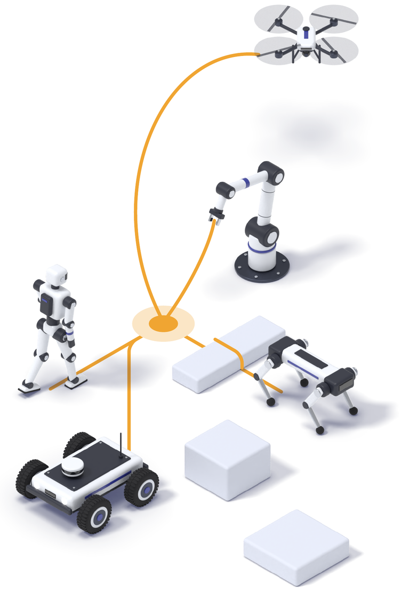

{: .align-right width="340px"}

I am a researcher in robotics and AI search at University of California, Irvine, working with Professor Sven Koenig in the [Intelligent Decision-Making (IDM)](https://idm-lab.org/) group. Before this, I received my Ph.D. from the University of New Hampshire (UNH) in May 2026, where I conducted my research independently while being fortunate and honored to collaborate closely with Professor [Oren Salzman](https://orensalzman.com/) of the [Technion-Israel Institute of Technology](https://www.technion.ac.il/en/).

<!-- I am an extremely self-motivated researcher with a strong focus on developing state-of-the-art algorithms in robot motion planning. My work addresses open questions in motion planning, with a particular interest in bidirectional heuristic search. --> 

My research centers on **building algorithmic and theoretical foundations for planning with strong theoretical guarantees on optimality, completeness, robustness, and reliability for robotics and intelligent Systems**. 
Rather than treating trade-offs between computational efficiency, solution quality,
and theoretical guarantees as inevitable, my research asks **: which computations are truly unnecessary to preserve these rigorous theoretical guarantees?**.

To answer this question, my research bridges discrete heuristic search and continuous motion planning, focusing on fundamental algorithmic principles that can be applied across different planning paradigms, from single-robot planning to multi-robot and multi-agent systems. My current work spans bidirectional and incremental heuristic search, optimal sampling-based motion planning, any-angle pathfinding, and multi-agent pathfinding, with broader interests in kinodynamic motion planning, task and motion planning, graph-based optimization, and optimal control. I am particularly into extending these algorithmic foundations to high-dimensional, nonholonomic, and kinodynamic systems, as well as dynamic and unknown environments.

Beyond developing individual planning algorithms, my long-term goal is to establish a unified algorithmic framework for efficient, scalable, and provably reliable autonomous decision-making, bridging theoretical insights with real-world applications.

I have also been a contributor to the [Open Motion Planning Library (OMPL)](https://ompl.kavrakilab.org/developers.html) since Oct 2025.

<!--I am currently collaborating with Professor Oren Salzman and [Dr. Eyal Weiss](https://eyal-weiss.github.io/) to optimize the interplay between sampling-based motion planning and bidirectional heuristic search, a novel framework that significantly improves solution-finding efficiency in high-dimensional continuous state spaces. This line of work will continue at UC Irvine under the guidance of Professor Sven Koenig.-->

Recent Posts
======
Tighter Bidirectional Heuristic Search and Lazy Optimal Sampling-Based Motion Planning. [Ph.D. Dissertation](https://scholars.unh.edu/cgi/viewcontent.cgi?article=4007&context=dissertation), May 2026, UNH.

Bidirectional Tight Informed Trees (BTIT*), Proceedings of ICCA 2026, 16-20 June, Almaty, Kazkhstan. [Invited paper](https://ieeexplore.ieee.org/abstract/document/11618013)

Bidirectional Lazy Informed Trees (BLIT*), Proceedings of [ICRA 2025](https://ras.papercept.net/conferences/scripts/myprogram.pl?ConfID=479), 19–23 May, Atlanta, USA. [pdf](https://ieeexplore.ieee.org/document/11128259)

Meet-in-the-middle with Early and Efficient Termination (MEET), Proceedings of [IJCAI 2025](https://2025.ijcai.org/), August 16-22, Montreal, Canada.[pdf](https://www.ijcai.org/proceedings/2025/0999.pdf)

EMPC-Based Flight Control and Collision-Free Path Planning for A Quadrotor with Unbalanced Payload. Proceedings of IEEE/ASME Transactions on Mechatronics ([TMECH](https://ieeexplore.ieee.org/abstract/document/11030654)) 2025. [pdf](https://ieeexplore.ieee.org/abstract/document/11030654)

Honors and Awards
======
Special IJCAI 2025 Doctoral Consortium Travel Award, awarded by the National Science Foundation (NSF).

Selected to present a [lightning talk](https://2025.ijcai.org/doctoral-consortium-program/) at the IJCAI 2025 Doctoral Consortium as one of six lightning talks of selected papers from main conference track.

Open soruce contributions
======
We have released C++ implementation of BLIT* for comparison-version via [github](https://github.com/yi213-robotic/BLITstar). 

BLIT* is already merged into Open Motion Planning Library [OMPL](https://github.com/ompl/ompl).

Highlights of My Work
======
(1) Bidirectional Lazy Informed Trees (BLIT*):

[Oral presentation](https://www.youtube.com/watch?v=9bctMp6n3ss&t=9s) at ICRA 2025, May 20, Atlanta, GA, USA.

Poster Presentation:
[BLIT_poster.pdf](https://github.com/user-attachments/files/20534131/BLIT_poster.pdf)

(2) Meet-in-the-middle with Early and Efficient Termination (MEET) 

[Main-Track oral presentation](https://2025.ijcai.org/montreal-main-track-accepted-papers/) at IJCAI 2025, Aug 22, Montreal, Canada.

[Lightning talk to the DC of IJCAI25](https://2025.ijcai.org/doctoral-consortium-program/) at IJCAI 2025, Aug 18, Montreal, Canada.

(3) EMPC-Based Flight Control and Collision-Free Path Planning.

An experimental demonstration video is [available here](https://www.youtube.com/watch?v=VFPGz-rjjQM).

